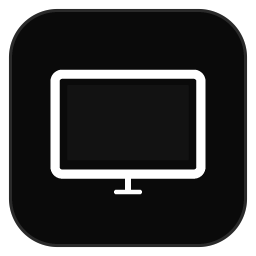
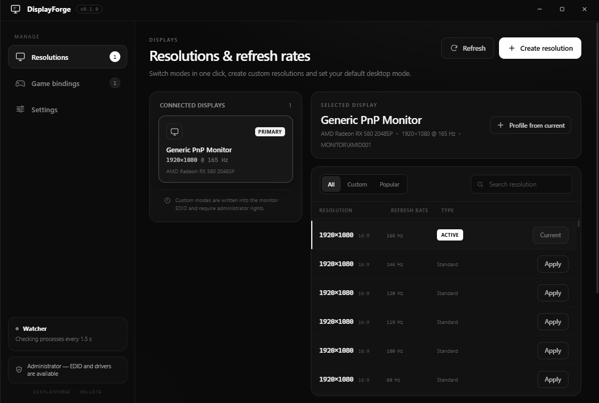
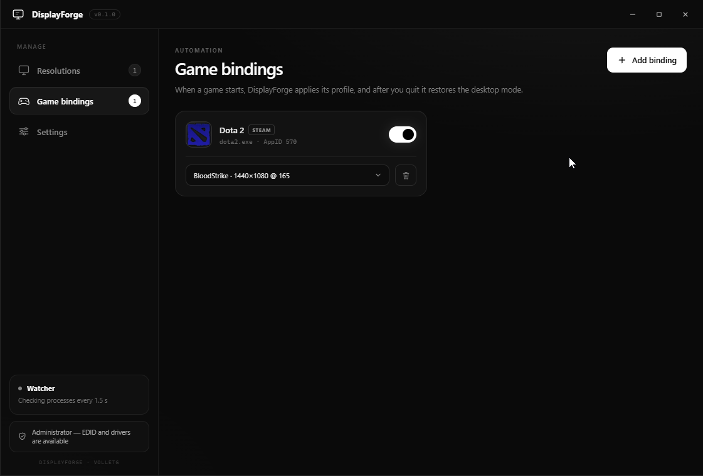
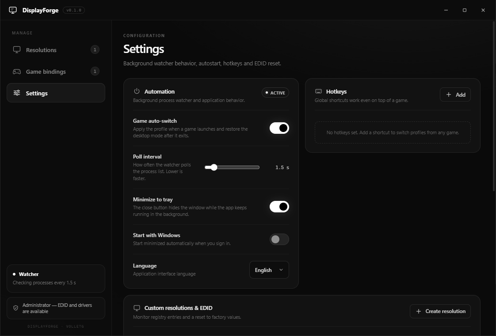

<div align="center">



# DisplayForge

**Программа для смены и создания разрешения с возможностью привязки к играм**

Windows 10/11 · v0.1.0 by VolletG

</div>

---

DisplayForge — приложение для управления режимами дисплея. Оно показывает доступные разрешения и частоты обновления, позволяет создавать собственные режимы и автоматически переключает монитор при запуске игры, возвращая рабочий режим после выхода.

Приложение работает полностью локально: без аккаунтов, облака, телеметрии и сетевых запросов.

## Возможности

### Дисплеи и режимы

- Список подключённых дисплеев с определением основного монитора.
- Все поддерживаемые разрешения и частоты обновления для каждого дисплея.
- Фильтры «Все / Кастомные / Популярные» и поиск по разрешению.
- Переключение режима в один клик.
- Подтверждение смены режима: если за 10 секунд не подтвердить изменение, приложение автоматически вернёт предыдущий режим — защита от чёрного экрана.
- Текущий режим рабочего стола можно закрепить как профиль по умолчанию.

### Кастомные разрешения

- Создание нестандартных разрешений и частот, которых нет в списке монитора.
- Режим добавляется на уровне EDID и применяется после перезапуска графического адаптера.
- Удаление отдельного кастомного режима или полный сброс EDID к заводскому состоянию.
- Требуются права администратора.

### Профили

- Профиль — это связка «дисплей + разрешение + частота».
- Быстрое переключение профилей из основного окна и из трея.
- Профиль по умолчанию для возврата на рабочий стол.
- Все настройки хранятся локально.

### Привязка игр

- Автоматический импорт установленных игр Steam.
- Добавление игры вручную через выбор `.exe`.
- Включение и отключение отдельных привязок.
- При запуске игры применяется её профиль, после завершения возвращается режим рабочего стола.

### Фоновый наблюдатель

- Проверка запущенных процессов каждые 1.5 секунды.
- Наблюдатель не вмешивается в ручную смену режима, ожидающую подтверждения.
- При выключенном авто-переключении процессы не сканируются.

### Горячие клавиши, трей и автозапуск

- Глобальные горячие клавиши для применения профиля.
- Иконка в системном трее с быстрым доступом к профилям, переключателем авто-смены и выходом.
- Сворачивание в трей вместо закрытия.
- Автозапуск вместе с Windows в скрытом режиме.

### Интерфейс

- Минималистичный тёмный интерфейс с собственной рамкой окна.
- Русский и английский языки с переключением на лету.
- Уведомления о применении режимов, ошибках и автоматических переключениях.

## Скриншоты







## Установка

1. Скачайте установщик из [последнего релиза](https://github.com/VolletG/Display-Forge/releases/latest):

   [`DisplayForge_0.1.0_x64-setup.exe`](https://github.com/VolletG/Display-Forge/releases/latest/download/DisplayForge_0.1.0_x64-setup.exe)

2. Запустите его. Установка выполняется для всех пользователей компьютера и требует прав администратора.
3. Если Windows SmartScreen покажет предупреждение о неизвестном издателе, выберите «Подробнее» → «Всё равно запустить». Сборка не подписана код-сертификатом.

SHA-256 установщика:

```text
01DE31C06E4650CF6945B1BD0E14A6E4E7E11B7CF0B133E9DAE8C2144C850DDA
```

Файл контрольной суммы: [`DisplayForge_0.1.0_x64-setup.exe.sha256`](https://github.com/VolletG/Display-Forge/releases/latest/download/DisplayForge_0.1.0_x64-setup.exe.sha256)

Проверка в PowerShell:

```powershell
Get-FileHash .\DisplayForge_0.1.0_x64-setup.exe -Algorithm SHA256
```

Значение `Hash` должно совпасть с указанным выше.

### Системные требования

- Windows 10 или Windows 11, 64-битная версия.
- Microsoft Edge WebView2 Runtime — установщик скачает и установит его при необходимости (нужен интернет).
- Права администратора для создания кастомных режимов. Остальные функции доступны без них.
- Steam — необязательно, только для автоматического импорта игр.

## Приватность

- Приложение не собирает аналитику и не отправляет данные в интернет.
- Список процессов читается локально и только для определения запуска игры.
- Из Steam используются только локальные сведения об установленных играх.
- Все настройки, профили и привязки хранятся на компьютере пользователя.
- Права администратора используются исключительно для работы с режимами дисплея.

## Предостережения

- Запись EDID и перезапуск графического адаптера зависят от драйвера и монитора. После сброса EDID может потребоваться перезагрузка.
- Неподдерживаемый режим может привести к чёрному экрану. В приложении есть 10-секундное подтверждение с автоматическим откатом, но изменения выполняются на ваш риск.
- Установщик не подписан, поэтому SmartScreen может показать предупреждение.
- Проект не связан с Valve, Steam, Microsoft или производителями мониторов.

## Лицензия

© 2026 VolletG. Все права защищены.

DisplayForge — закрытое программное обеспечение. Программа распространяется только в виде оригинального установщика с GitHub Releases. Декомпиляция, модификация, перепродажа и публикация изменённых сборок без письменного разрешения автора запрещены.

---

## English

DisplayForge is a closed-source Windows 10/11 utility for managing display modes: it lists resolutions and refresh rates, creates custom modes, stores profiles, and switches the display automatically when a bound game starts, restoring the desktop mode on exit. Fully local — no telemetry, no network requests.

- Download: [latest release](https://github.com/VolletG/Display-Forge/releases/latest)
- © 2026 VolletG. All rights reserved. Distributed only as the original installer from GitHub Releases.
